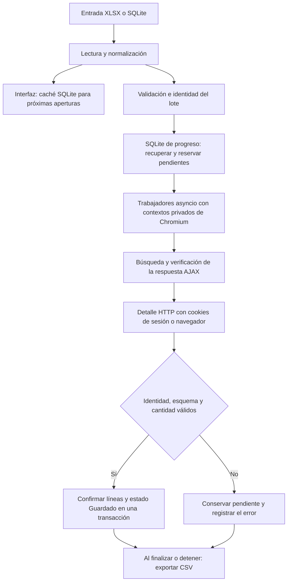

# BLs_BOT: funcionamiento, uso y documentación técnica

Documentación de la implementación en `src/`, rama `AstraCode/bls-asyncio`,
revisada el **12 de octubre de 2026**. Los detalles corresponden al código
del repositorio; las mediciones históricas se identifican por separado.

## 1. Qué hace el bot

BLs_BOT automatiza la consulta de conocimientos de embarque (**BL**) en el
portal de consultas TICA del Ministerio de Hacienda de Costa Rica. Recibe una
base generada desde Conocimientos en Manifiestos, busca cada BL dentro de su
manifiesto y rango de fechas, y extrae las líneas de detalle.

El resultado se confirma primero en SQLite local. Después se generan CSV
para trabajar con las líneas descargadas y revisar casos sin líneas o pendientes.
Se puede detener y continuar una descarga recuperando los BL ya confirmados.

Filas de entrada, BL consultados y líneas obtenidas son cantidades diferentes:
un BL puede tener varias líneas, ninguna, o estar repetido en la entrada.

## 2. Flujo de funcionamiento



1. Se abre la base conservando identificadores como texto. Se normalizan las
   fechas y se derivan los componentes del manifiesto.
2. Una firma SHA-256 de la selección y sus filtros determina el lote. SQLite
   recupera el progreso o crea uno nuevo.
3. Cada trabajador reserva un pendiente mediante un token. Una respuesta
   antigua no puede confirmar una reserva posterior.
4. Chromium completa el formulario de TICA. El bot comprueba que los valores
   enviados y la respuesta AJAX correspondan al BL y las fechas solicitadas.
5. Se selecciona una coincidencia exacta de manifiesto, BL y secuencia. El
   detalle usa el enlace entregado por TICA y las mismas cookies de sesión.
6. Se verifican identidad, columnas y cantidades. Las líneas y el estado
   **Guardado** se confirman juntos en una transacción.
7. Al finalizar o detener se exportan los resultados y los informes de revisión.
   No se anuncia una descarga completa si quedan pendientes o inválidos.

## 3. Tecnologías

Las versiones son las fijadas en [requirements.txt](../requirements.txt) y
[requirements-dev.txt](../requirements-dev.txt).

| Tecnología | Versión o procedencia | Función |
| --- | --- | --- |
| Python | Desarrollo: 3.12, Windows de 64 bits | Lenguaje de la aplicación |
| Tkinter y ttk | Biblioteca estándar | Ventana, controles, tabla y panel de carga |
| asyncio | Biblioteca estándar | Consultas concurrentes y cancelación |
| threading y queue | Biblioteca estándar | Separar carga y procesamiento del hilo de la interfaz |
| Playwright | 1.62.0 | Control de Chromium y HTTP con cookies de sesión |
| Chromium | Versión requerida por Playwright | Ejecutar el formulario JavaScript de TICA |
| pandas | 2.2.3 | Lectura y normalización en un DataFrame |
| openpyxl | 3.1.5 | Lectura de XLSX |
| Beautiful Soup | 4.12.3 | Análisis del HTML y las tablas |
| lxml | 5.3.0 | Dependencia declarada; el parser actual usa `html.parser` |
| sqlite3 / SQLite | Incluido con Python | Caché y persistencia del progreso |
| hashlib, json, csv y logging | Biblioteca estándar | Firmas, datos, exportación y diagnóstico |
| PyInstaller | 6.19.0 | Ejecutable de Windows |
| unittest | Biblioteca estándar | Pruebas automatizadas |

El motor actual usa Playwright y no requiere un EdgeDriver separado. SQLite
guarda información en archivos locales y no necesita un servidor.

## 4. Entrada y conservación de ceros

### Excel

Se admite `.xlsx`, normalmente con la hoja **BLS**. Las columnas mínimas del
lector son `IDManifiesto`, `BL original` y `Fecha Manifiesto`. La base generada
por Conocimientos contiene estas cinco columnas:

| Columna | Significado |
| --- | --- |
| `IDManifiesto` | Identidad completa del manifiesto, con cinco componentes |
| `Secuencia Tica` | Secuencia para distinguir el BL en el manifiesto |
| `BL original` | Identificador enviado al formulario de TICA |
| `Fecha Manifiesto` | Fecha de arribo, normalizada como `dd/mm/aaaa` |
| `Mes` | Referencia de la base generada |

Ejemplo de manifiesto: `4-0-26000125-P010-01/04/26`. Su fecha debe coincidir
con `01/04/2026`. Una secuencia suministrada debe ser numérica y mayor que cero.
Un BL vacío o una identidad incompatible quedan **Inválido**, sin consulta.
Errores generales como columnas requeridas ausentes o todas las fechas
inválidas rechazan el archivo completo.

### SQLite de Conocimientos

Se admiten `.sqlite3`, `.sqlite` y `.db`. El contrato es una única tabla **BLS**
con las cinco columnas anteriores, en ese orden, declaradas como **TEXT**.
Las filas deben contener textos sin nulos y se leen en orden `rowid`.
La hoja lógica siempre es **BLS**, aunque se renombre el archivo. La
normalización es la misma que para Excel.

También se pueden abrir las cachés internas del bot. No cualquier SQLite
es compatible: la base de progreso no se puede usar como entrada.

### Ceros iniciales

El BL se lee como texto, se conserva en la caché y se introduce en TICA con
sus ceros: `000123456` se consulta como `000123456`. Los intentos no agregan
ni eliminan ceros para probar variantes. Solo se recortan espacios exteriores.

La garantía requiere que los ceros existan en el dato original. Si Excel
almacena `123456` como número y muestra ceros mediante un formato de celda,
el lector no reconstruye un identificador que no está almacenado como texto.
El generador debe entregar BL y secuencia como texto desde el origen.

La secuencia conserva su representación textual, pero su comparación e
identidad lógica son numéricas: `001` y `1` representan la misma secuencia.

## 5. Los tres usos de SQLite

| Base | Estructura principal | Uso |
| --- | --- | --- |
| Entrada de Conocimientos | Tabla `BLS` con cinco columnas TEXT | Selección original que se consultará |
| Caché interna | Tablas `metadata` e `input_rows` | Restaurar filas ya normalizadas |
| Progreso del lote | `metadata`, `jobs`, `inputs`, `results`, `runs`, `attempts` | Reanudación, intentos y resultados |

La GUI guarda la caché en `data/Datos_Cargados/<hoja>.sqlite3`. Sus metadatos
incluyen versión, columnas, cantidad, origen y hoja; cada fila es una lista
JSON de textos, ordenada por posición. La lectura verifica esquema, tipos
y cantidad. La escritura usa un temporal y reemplazo atómico para preservar
la caché anterior si falla la escritura.

Las entradas SQLite se abren en modo de solo lectura. El original de
Conocimientos no recibe cambios ni metadatos: la caché se genera por separado.

La base de progreso está en `<lote>/SQLite/bls.sqlite3`:

| Tabla | Contenido |
| --- | --- |
| `metadata` | Firma, filtros y esquema de resultados |
| `jobs` | Trabajo único, estado, intentos, error, token y cantidad de líneas |
| `inputs` | Todas las filas originales y su referencia al trabajo |
| `results` | Líneas confirmadas en orden |
| `runs` | Ejecuciones y sus estados finales |
| `attempts` | Historial de reservas e intentos |

Un bloqueo de escritor evita procesar el mismo lote desde dos instancias
simultáneamente. Al reabrir después de una interrupción, las reservas que
quedaron **Descargando** vuelven a **Pendiente**. Los confirmados se conservan.
La exportación independiente usa una instantánea de solo lectura.

## 6. Uso de la interfaz

1. Abrir `dist/BLs_BOT_AstraCode.exe`, o `run_bot.py` en desarrollo.
2. Esperar al panel de carga. Se restaura la base de la hoja configurada;
   si solo existe el Excel de la caché anterior, se convierte una vez.
3. Pulsar **Seleccionar base…** para importar XLSX o SQLite y revisar la hoja.
4. Revisar salida, concurrencia, intentos y fechas.
5. Pulsar **Iniciar**. Si falta Chromium, se muestra su preparación y descarga.
6. Usar **Detener**, esperar y volver a pulsar **Iniciar** para continuar.

Durante restauración, importación y cambio de hoja, el panel animado bloquea
botones, campos, pestañas y tabla. Un hilo independiente hace la lectura;
el hilo de Tk recibe el resultado por una cola. Si la selección falla, se
conserva la entrada anterior y se habilitan los controles. Cerrar durante
la carga espera a que termine la operación.

Con **Usar el mes de arribo de cada BL** activado, se consulta desde el primer
hasta el último día del mes de `Fecha Manifiesto`, incluido su año. La columna
`Mes` no determina ese rango. Al desactivarlo se usan las fechas manuales.

### Estados y «Registros»

| Estado | Significado | Registros |
| --- | --- | --- |
| `Pendiente` | Sin consultar o sin resultado confirmado | Cero; no acredita que esté vacío |
| `Descargando` | Consulta en curso | Todavía no hay resultado confirmado |
| `Guardado` | Respuesta validada y confirmada en SQLite | Cantidad de líneas guardadas del BL |
| `Inválido` | No pasó la validación de entrada | Cero; no se consultó |

**Registros** son las líneas válidas y guardadas del BL de esa fila. No son
intentos, BL procesados ni el total de la base. **Guardado** con cero registros
significa detalle confirmado sin líneas. Una búsqueda sin coincidencia queda
pendiente y no se trata como vacío confirmado.

La barra compara trabajos únicos guardados con trabajos únicos totales.
Entradas repetidas comparten consulta, por lo que el total puede ser menor
que las filas de origen. La ventana muestra hasta 1.000 trabajos; SQLite
conserva la selección completa.

## 7. Concurrencia, reintentos y conexión

`cant_hilos` configura **trabajadores asíncronos**: 1–20, con 2 por defecto.
Un Chromium compartido contiene un contexto privado y una página por
trabajador. La GUI ejecuta el motor fuera del hilo de Tk. Cambiar el ajuste
durante una ejecución no modifica los trabajadores creados: detener y
reiniciar permite aplicar el nuevo valor.

Los contextos se reutilizan para reducir preparaciones y se renuevan entre
consultas a los 100 usos o 600 segundos. Ante errores se descartan. La búsqueda
requiere el formulario JavaScript; el detalle usa HTTP por defecto y las
cookies del mismo contexto. Existe la estrategia de detalle en navegador,
incluida la recuperación ante ciertos controles de paginación. Si todavía
hay páginas de detalle no soportadas, el trabajo queda pendiente para evitar
guardar una parte como si fuera el resultado completo.

`max_retries` limita las rondas por ejecución, **incluido el primer intento**:
3 por defecto, entre 1 y 10. Las rondas siguientes repiten fallos transitorios
o interrupciones, con pausas de 2, 4 y luego hasta 5 segundos. Una respuesta
incompatible o sin coincidencia no se repite automáticamente en esas rondas.
Otra ejecución retoma los pendientes; el contador de intentos es acumulado.

Ante un posible corte se comprueba Internet con servicios independientes de
TICA. Un corte confirmado genera una pausa compartida sin límite de espera,
con comprobaciones cada diez segundos. Al reconectar se repite el BL con
la misma reserva y sin otro intento. **Detener** sigue disponible. Un fallo
exclusivo de TICA o una comprobación inconclusa mantiene reintentos limitados.

Más trabajadores no garantizan una mejora proporcional: influyen el portal,
la conexión y los recursos del equipo. Para estimar duración conviene medir
BL guardados por minuto en un intervalo estable; las líneas extraídas por
minuto no equivalen a BL por minuto.

## 8. Reanudación e identidad del lote

La firma incluye registros normalizados y su orden, hoja, modo de fechas,
URL de consulta y fechas manuales cuando corresponden. La revisión generada
por **Nueva descarga** también cambia la identidad.

Renombrar o mover el archivo de origen no cambia la firma. XLSX y SQLite con
los mismos datos normalizados, columnas, orden y hoja recuperan el mismo lote.
Concurrencia y estrategia de detalle tampoco cambian la identidad. Cambiar
contenido, orden, hoja o filtros relevantes puede crear otro lote.

Para continuar, mantener selección y filtros y apuntar a la carpeta que
contiene el progreso. Pulsar **Iniciar**, sin usar **Nueva descarga**. Cambiar
la carpeta de salida no cambia la firma, pero el bot buscará la base allí:
hay que trasladar también el lote si se desea retomarlo.

Filas con la misma identidad de manifiesto, secuencia y BL comparten trabajo.
Se mantienen todas las referencias de entrada; el CSV repite las líneas por
cada referencia, respetando el orden original.

## 9. Resultados

```text
<salida>/<hoja>/<primeros 16 caracteres de la firma>/
  SQLite/
    bls.sqlite3
    bls.sqlite3.lock
  CSV/
    Duas_procesados_<hoja>.csv
    BLs_sin_lineas.csv
    BLs_pendientes.csv
```

| Archivo | Contenido |
| --- | --- |
| `Duas_procesados_<hoja>.csv` | Líneas confirmadas, en orden de entrada y detalle |
| `BLs_sin_lineas.csv` | Entradas confirmadas sin líneas |
| `BLs_pendientes.csv` | Pendientes e inválidos, con intentos y errores |

El CSV principal tiene las 18 columnas visibles más `manifiesto` y `bls`:
`Contenedor Asociado`, `Pendientes`, `Afectaciones`, `Sob/ Falt`, `Retenciones`,
`Nro`, `Peso`, `Tipo de Bulto`, `Total de Bulto`, `Usado`, `Dep.Dest.`,
`Ubicacion`, `Aduana`, `Marcas`, `Estado`, `Tipo de operación`, `Categoria`
y `Cod. Mercancia Peligrosa`.

Los primeros cinco campos son indicadores del portal y actualmente se
exportan vacíos. El resto del detalle se guarda como texto con recorte de
espacios y la normalización actual de comas y comillas; no es una copia
literal de todo el HTML. Los CSV usan UTF-8 con BOM, archivo temporal y
reemplazo atómico.

SQLite guarda cada BL durante la ejecución. Los CSV se exportan al finalizar
o detener. Si Excel bloquea un CSV, el progreso permanece en SQLite: cerrar
el archivo y pulsar **Iniciar** permite exportar sin repetir confirmados.
Al importar CSV en Excel, definir identificadores como texto evita que Excel
quite sus ceros al mostrarlos.

## 10. Configuración

Los valores están en [config.example.json](../config.example.json). Los
ajustes personales se guardan en `config.json`, fuera de Git.

| Clave | Valor inicial | Función |
| --- | --- | --- |
| `sheet_name` | `BLS` | Hoja y carpeta de resultados |
| `cant_hilos` | `2` | Trabajadores: 1–20 |
| `output_base_path` | Vacío | Usa `output/` en la carpeta de la app |
| `max_retries` | `3` | Rondas por ejecución: 1–10 |
| `timeout` | `30` | Segundos por operación; rango en GUI: 5–120 |
| `headless` | `true` | Chromium sin ventana visible |
| `target_url` | Portal TICA de conocimientos | Formulario de consulta |
| `fecha_inicio` / `fecha_fin` | `01/01/2025` / `31/12/2025` | Rango manual |
| `dates_from_input` | `true` | Mes de arribo de cada BL |
| `reuse_context` | `true` | Reutilizar sesiones |
| `detail_strategy` | `http` | Detalle por `http` o `browser` |
| `batch_revision` | Vacío | Revisión adicional de Nueva descarga |

El timeout no limita la duración total de un BL: una consulta realiza varias
operaciones. Los valores predeterminados completan configuraciones antiguas.
Las opciones técnicas no expuestas en la ventana se cambian en el archivo,
antes de iniciar.

## 11. Instalación, consola y compilación

### Desarrollo

Desde la raíz, con Windows de 64 bits, Python 3.12 y Tkinter:

```powershell
python -m venv .venv
.\.venv\Scripts\python.exe -m pip install -r requirements-dev.txt
.\.venv\Scripts\python.exe run_bot.py
```

Para ejecutar sin compilar basta `requirements.txt`; el archivo de desarrollo
añade PyInstaller. La primera preparación necesita Internet para descargar
Chromium si falta. El `.exe` incluye Python y no requiere instalarlo en destino.

### Consola

Estos ejemplos consultan TICA con una muestra pequeña y salida independiente:

```powershell
.\.venv\Scripts\python.exe run_cli.py --archivo "ruta/base.xlsx" --hoja BLS --limite 2 --concurrencia 2 --salida "logs/prueba_excel"
.\.venv\Scripts\python.exe run_cli.py --archivo "ruta/base.sqlite3" --limite 2 --salida "logs/prueba_sqlite"
```

Opciones: `--archivo`, `--hoja`, `--limite`, `--salida`, `--concurrencia`,
`--intentos`, `--detalle http|browser` y `--contexto-nuevo`. La salida es
obligatoria; sin límite se procesa toda la selección. En SQLite la hoja es
opcional, pero si se indica debe coincidir con la de la base. La CLI usa
fechas de entrada, navegador oculto y timeout mínimo de 15 segundos. Imprime
un resumen JSON y no crea la caché de la interfaz.

Exportación existente, sin TICA ni cambios de progreso:

```powershell
.\.venv\Scripts\python.exe run_cli.py --exportar-db "ruta/lote/SQLite/bls.sqlite3" --salida "ruta/exportacion.csv"
.\.venv\Scripts\python.exe run_cli.py --help
```

En descarga, `--salida` es carpeta base; al exportar es el archivo CSV destino.

### Ejecutable

Cerrar la app y, con las dependencias de desarrollo instaladas, ejecutar:

```powershell
.\build.bat
.\dist\BLs_BOT_AstraCode.exe --verificar-instalacion logs/verificacion.json
```

PyInstaller genera un ejecutable único sin consola. El candidato queda en
`build/release/` y se actualiza el `.exe` de `dist/`, conservando datos y
configuración. Si está abierto, cerrar la app antes de reemplazarlo.

La verificación escribe un JSON con `ready: true` si todo pasa. Prueba
Chromium en una página local, Excel textual, ambas entradas SQLite, ceros,
reanudación entre formatos, persistencia y reconexión simulada. No consulta
TICA, aunque puede instalar Chromium si falta.

## 12. Organización del código

| Ubicación | Responsabilidad |
| --- | --- |
| `run_bot.py` / `run_cli.py` | Lanzadores desde la raíz |
| `src/main.py` | GUI, carga y cola de eventos |
| `src/cli.py` | Descarga y exportación por consola |
| `src/data_reader.py` | Lectura y normalización compartida |
| `src/input_files.py` | Formatos, hojas y contratos de entrada |
| `src/input_cache.py` | Caché SQLite |
| `src/config_manager.py` / `src/paths.py` | Configuración y rutas |
| `src/core/inputs.py` | Validación, fechas e identidades |
| `src/core/engine.py` | Trabajadores, rondas y cancelación |
| `src/core/tica.py` / `src/core/tables.py` | Consultas y validación TICA |
| `src/core/store.py` | Bloqueo, transacciones y exportaciones |
| `src/core/browser_runtime.py` | Preparación de Chromium |
| `src/core/internet.py` | Corte y pausa compartida |
| `src/core/self_test.py` | Verificación local |
| `tests/` | Regresiones con datos temporales |
| `scripts/` | Medición y compatibilidad acotadas |
| `docs/` | Manual, arquitectura y registros técnicos |

`src/` contiene la implementación actual. `.venv/`, `build/`, `dist/`,
`data/`, `output/`, `logs/`, `tmp/` y `config.json` son locales, fuera de Git.
En desarrollo se escribe en la raíz; en distribución, junto al `.exe`,
salvo una salida externa. No se escribe progreso en el temporal de PyInstaller.
La GUI registra diagnósticos en `logs/debug.log` de su carpeta de aplicación.

## 13. Rendimiento de carga

La caché evita analizar XLSX en cada apertura. En esta PC, una prueba del
12 de octubre de 2026 con **440.016 filas** registró:

| Operación | Tiempo |
| --- | ---: |
| Primera preparación: Excel y creación de caché | 61,295 s |
| Siguiente apertura: restauración SQLite | 2,090 s |
| Lectura independiente de la caché | 1,988 s |

Son mediciones de ese equipo y base, con caché del sistema. La primera incluye
conversión y no mide solo lectura de Excel. No incluyen extracción del `.exe`
ni importaciones previas a la ventana; tampoco miden consultas a TICA.

Se sigue cargando la selección completa en un DataFrame: RAM, disco y tamaño
influyen. SQLite de Conocimientos evita interpretar XLSX, pero requiere leer
y normalizar filas. Detalles en [ARRANQUE.md](ARRANQUE.md).

## 14. Respaldo, traslado y diagnóstico

Detener, esperar y cerrar antes de copiar. Trasladar `dist/` con `config.json`,
`data/` y `output/` completos. Si la salida es externa, copiarla y ajustar su
ubicación. En otra PC Windows de 64 bits, mantener selección y filtros y
pulsar **Iniciar**. Chromium se instala para el usuario si falta.
Los estados históricos de motores retirados se conservan en `data/history/`,
sin convertirlos automáticamente en éxitos.

| Situación | Acción |
| --- | --- |
| Primera carga lenta | Esperar conversión; las siguientes usan caché |
| SQLite rechazado | Revisar que sea tabla BLS o caché, no progreso |
| Importación fallida | Revisar columnas, fechas y tipos; la entrada anterior permanece |
| BL Inválido | Corregir la base de origen y revisar la identidad del lote resultante |
| Pendiente con `no_match` | Revisar manifiesto, BL, secuencia y rango; no acredita un vacío |
| `invalid_response` | Revisar error y cambios del portal; no se guardan parciales |
| Esperando conexión | Esperar reconexión o usar Detener |
| Fallo al instalar Chromium | Revisar Internet, permisos y log; volver a iniciar |
| CSV bloqueado | Cerrar Excel y exportar de nuevo |
| Lote ocupado | Detener y cerrar la otra instancia |
| Ceros ausentes en Excel | Importar columnas como texto y revisar el origen |

Para investigar, conservar entrada, lote completo y `logs/debug.log`,
indicando BL, manifiesto, estado y mensaje del error.

## 15. Pruebas y documentación complementaria

```powershell
.\.venv\Scripts\python.exe -m unittest discover -s tests -v
```

Las pruebas cubren persistencia, reanudación, reservas, ceros, formatos,
exportación, navegador, Internet y bloqueo durante la carga. Usan temporales
y sesiones simuladas; no acreditan que TICA no haya cambiado. Tras cambios
funcionales se recompila y verifica el ejecutable. Las pruebas reales requieren
muestras acotadas y una carpeta separada del progreso de producción.

- [Instalación y uso rápido](../README.md).
- [Arquitectura y mantenimiento](ARQUITECTURA.md).
- [Carga rápida y mediciones](ARRANQUE.md).
- [Contrato y pruebas con Conocimientos](COMPATIBILIDAD_CONOCIMIENTOS_20261012.md).
- [Registro de optimización](OPTIMIZACION_20261006.md).
- [Herramientas de comprobación](../scripts/README.md).
