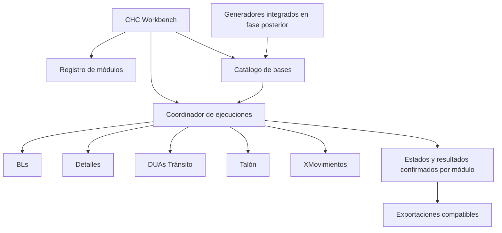

# Arquitectura propuesta

El repositorio contiene módulos independientes; la plataforma coordinará su
ejecución. Esta arquitectura es el destino planificado, no una implementación
completa en la entrega inicial.

El panel utiliza Python + PySide6 + Qt Quick/QML. Detalles ya tiene una página
operativa: `DetailsBridge` supervisa su worker mediante QProcess/JSONL. Su motor
y SQLite permanecen en un proceso separado. `demo.py` sirve las demostraciones
de los otros cuatro módulos. El coordinador global y la integración de bases
todavía son fases posteriores. Ver `INTEGRACION_DETALLES.md` para el flujo actual.

## Límites de responsabilidad

| Componente | Responsabilidad |
| --- | --- |
| `workbench/` | Descubrimiento, navegación, supervisión y presentación |
| `bots/<id>/` | Reglas, formulario, extracción y validación específicas |
| `integrations/` | Generación e importación de bases y procedencia |
| Servicios comunes futuros | Rutas, configuración, eventos, instalación y contratos |
| Almacenamiento operativo futuro | Datasets, lotes, resultados, logs y respaldos fuera de fuentes |
| `tools/` | Verificación y herramientas de mantenimiento |

No se añade una carpeta de servicios con implementaciones duplicadas antes de
extraer un contrato real. Tampoco se introduce una base única que sobrescriba las
bases de progreso existentes. El catálogo global apuntará a datasets y lotes;
cada módulo puede conservar almacenamiento propio durante la transición.

## Registro inicial

`workbench/modules.json` usa ID estable, ruta relativa, punto de entrada, requisitos,
recursos, contrato de entrada y estado de integración. Los consumidores deben
resolver rutas respecto a la raíz del repositorio. No contiene rutas absolutas
para ejecutar módulos. No importa código de los bots ni inicia descargas.

Los documentos de procedencia sí conservan rutas originales como evidencia.

## Aislamiento y extensibilidad

El primer acceso común iniciará subprocesos con directorio de trabajo y Python
propios. Un módulo nuevo se incorporará con su carpeta y descriptor, sin añadir
condicionales por nombre en la interfaz. Mientras las GUI actuales importen
`utils`, `core` y `ui` globalmente, no deben cargarse juntas en un proceso.

El contrato futuro de motor incluirá: describir capacidades, validar una entrada,
iniciar un lote, detener de forma ordenada, emitir eventos y exportar resultados.
Cada evento identificará módulo, lote y trabajo. Una detención solicitará cancelar;
cerrar la interfaz no debe terminar a la fuerza una escritura en curso.

## Datos e invariantes

- BL, secuencias, DUA y campos extraídos se preservan como texto.
- Un resultado y su estado confirmado se guardan juntos.
- La identidad del lote incluye la selección y sus parámetros relevantes.
- Un dataset completo acredita origen, período y cobertura; un archivo existente
  o una última fila procesada no demuestra éxito.
- Excel/CSV son formatos de intercambio; no coordinan la ejecución integrada.
- Los esquemas de salida permanecen compatibles durante cada migración.
- Los trabajadores conservan contextos de navegador privados y límites globales.

## Rutas en la primera entrega

Los cinco módulos aún escriben configuración y datos bajo su propia raíz, igual
que en desarrollo en los proyectos anteriores. La copia de `v2/src` a
`bots/<id>/src` conserva esa relación. El traslado a almacenamiento operativo
común exige adaptar las rutas y probar recuperación; no se simula con enlaces a
datos ni configuraciones de producción.

Detalles agrega su propio entorno y worker. La copia nueva contiene solamente
una tabla de validación de dos DUAs reales confirmados; no apunta al almacenamiento
del bot original. La interfaz clásica de la copia comparte esta raíz local.
