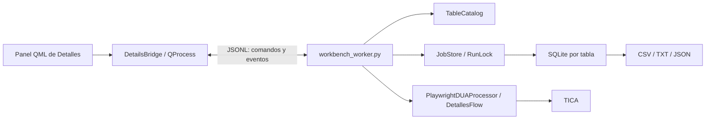

# Detalles integrado en CHC Workbench

Preferencia vigente del usuario: mantener la interfaz sencilla y cercana a la
clásica. Detalles abre directamente con Procesamiento y Configuración; Base de
datos se abre aparte. Exportación, actualización y compatibilidad clásica están
en Más; los parámetros técnicos quedan plegados. No repetir pruebas extensas
por cambios visuales: una comprobación breve basta; ampliar solo ante cambios
sensibles de motor, datos o recuperación.

Fecha: 12 de octubre de 2026. Esta es la primera integración operativa del
Workbench. Posteriormente se integró DUAs Tránsito con soporte común en
`chc_runtime/`; BLs, Talón y XMovimientos siguen en demostración. El motor
Workbench de Detalles usa ahora esa infraestructura, conservando sus tablas,
38 campos y la compatibilidad de los resultados. Ver `INTEGRACION_TRANSITO.md`.

El [piloto diario](PILOTO_DETALLES_DIARIO.md) añade base propia sin Excel,
calendario y acumulación mensual en una rama de prueba. Manual sigue disponible.

## Uso

1. Abrir `Abrir_Workbench.bat`; inicia directamente en **Detalles**.
2. Abrir una tabla guardada o pulsar **Elegir Excel…**. Elegir hoja y nombre,
   revisar el destino y confirmar **Crear tabla** o **Agregar DUAs**.
3. Elegir la carpeta de resultados. La importación no consulta TICA.
4. Revisar los parámetros en **Configuración**. Guardarlos o iniciar: los cambios
   pendientes se guardan antes de ejecutar.
5. Pulsar **Iniciar consultas** o **Retomar pendientes**. **Detener** solicita
   cancelación, conserva resultados y devuelve los trabajos interrumpidos a pendientes.
   El tiempo restante se estima con confirmaciones reales de la ejecución actual:
   ventanas de 30/90 segundos, sin contar éxitos anteriores ni entradas inválidas.
   El ritmo incorpora hilos, esperas y reintentos. Se muestra calculando durante
   la muestra inicial o si pasan 60 segundos sin confirmaciones. Es una estimación
   de los pendientes al ritmo observado, no una garantía de completar DUAs fallidos.
6. Revisar **Base de datos** para buscar, filtrar, paginar, seleccionar filas o
   inspeccionar las 38 columnas de un resultado, sus errores, origen e intentos.
7. **Más… → Exportar resultados** actualiza el CSV sin consultar el portal.
   **Resultados** abre la carpeta específica de la tabla.

La tabla **Validación · 2 DUAs originales** contiene la prueba real de esta entrega.
Se registraron sus resultados e historial en la instalación nueva sin repetir las
consultas. No representa una importación completa del mes original.

## Instalación propia

El panel usa `workbench/.venv/`; Detalles usa `bots/detalles/.venv/`. No se necesita
el ejecutable ni el entorno del repositorio original. En un equipo nuevo:

```powershell
Instalar_Workbench.bat
Instalar_Detalles.bat
Abrir_Workbench.bat
```

`Instalar_Detalles.bat` instala el lock de dependencias comprobado y Chromium.
El panel comprueba que exista el navegador y muestra cómo instalarlo si falta.
La preparación no hace consultas al portal. El lock incluye Playwright 1.63.0,
pandas 2.3.3, openpyxl 3.1.5 y las dependencias del flujo existente, incluido Selenium.

## Arquitectura y conservación del motor



El proceso Qt no importa `core`, `flows`, `ui` ni `utils` del bot. El worker usa
las clases actuales en un proceso con sus dependencias propias. Los 44 archivos
copiados de Detalles mantienen sus bytes originales: no se reescribieron motor,
formulario, CAPTCHA, parser, catálogo o esquema SQLite.

El worker agrega supervisión y un monitor de lectura del progreso para mostrar
las consultas en curso antes de que finalicen. La reserva y confirmación siguen
siendo responsabilidad de JobStore. Las lecturas de tablas/filas no recuperan
reservas ni cambian el estado de otra instancia.

Los comandos de modificación se bloquean durante importación/consulta. Las vistas
de filas y detalles pueden consultarse durante la ejecución mediante conexiones
SQLite de solo lectura. Cerrar el Workbench solicita detener y espera exportación,
cierre del navegador y terminación del proceso; no lo mata a la fuerza.

## Matriz de funciones conservadas

| Función del bot actual | Workbench / implementación conservada |
| --- | --- |
| Elegir Excel `.xlsx` y hoja | Diálogo de archivo; hoja seleccionable en Importar Excel |
| Columna única `NroDUA`, ceros iniciales, normalización | `JobStore.import_excel` y `core.identifiers`, sin cambios |
| Duplicados, filas vacías/incorrectas y transacción de importación | Misma validación; inválidas conservan fila/origen y no van a TICA |
| Nombre editable, Unicode y comparación sin mayúsculas/espacios externos | `table_name` y `TableCatalog.find_by_name` |
| Confirmar destino antes de crear/agregar | Revisión de destino; `expected_target` vuelve a comprobarlo al importar |
| Agregar quincenas al mismo nombre | Importación append; conserva resultados, intentos y pendientes |
| Omitir DUAs ya registrados o con resultados archivados | Unicidad SQLite y comprobación de `retained_results` |
| Reportar nuevos/existentes/inválidos e historial | Aviso y actividad; informes/transacciones originales en SQLite |
| Tabla con identidad independiente del archivo Excel | Mismo catálogo, UUID y esquema de lote |
| Reabrir sin Excel, última tabla y descubrimiento de lotes anteriores | Sesión y `TableCatalog.discover_legacy`; fallback de identidad anterior |
| Abrir y renombrar tablas | Selector y Base de datos; la salida usa el nombre actual de la tabla, sin UUID visible |
| Todas/pendientes/guardadas/reintentos | Filtros de Base de datos con búsqueda DUA/error |
| Paginación de 100 filas | Anterior/Siguiente; consultas originales parametrizadas |
| Selección de varias filas | Casillas y eliminación de elegidas con confirmación |
| Eliminar filas, limpiar completadas, eliminar tabla | `TableCatalog.remove_rows/delete_table`; respaldo previo y conservación de resultados/exportaciones |
| Abrir respaldos para recuperación manual | Botón Respaldos; no se inventa una restauración automática |
| DUA, estado, intentos y mensaje breve | Listado SQLite y detalle por fila |
| Error técnico, evidencia HTML/JSON, filas de origen | Detalle y Abrir evidencia; archivos e historial permanecen en SQLite/diagnósticos |
| 38 columnas del resultado, texto y orden originales | Parser y exportación originales; visor con los 38 campos |
| Concurrencia de 1 a 20; predeterminado 1 | Configuración y validación del worker |
| Timeout de 5 a 120 s; predeterminado 30 | Configuración; sigue siendo límite por operación |
| Rondas de 1 a 10; predeterminado 3 | Reintentos originales, máximo 2 trabajadores en rondas posteriores |
| Navegador oculto/visible | Parámetro `headless` guardado |
| Reutilización de contexto y detalle simplificado | Configurables; renovación por error, 100 usos o 600 s, sin cambios |
| Formulario, eventos, guardia de POST/AJAX e identidad | `portal_form`, `detail_navigation` e `identifiers` originales |
| Catálogo CAPTCHA interno de 191 entradas | JSON original, carga única y búsqueda por número de imagen |
| Casos de clic adicional | Permanecen pendientes; no se automatiza el paso extra |
| Iniciar/retomar/actualizar resultados, 100% solo confirmado | Botón según estado; resultados ya guardados no se consultan de nuevo |
| Guardados, pendientes, en curso, inválidos, intentos y porcentaje | Métricas del almacenamiento real, no una simulación |
| Detener, reiniciar app y recuperar intentos interrumpidos | Mismo stop_event, RunLock y begin_run; cierre ordenado |
| Bloqueo entre instancias y rollback de errores | RunLock y transacciones originales; no restablecer reservas ajenas |
| Migrar CSV anterior de 38 columnas al importar una tabla nueva | Ruta legacy y `migrate_csv` originales; solo resultados completos válidos del lote |
| Exportar cada 60 s y al terminar/detener | `PlaywrightDUAProcessor` y `JobStore.export` sin cambios |
| CSV UTF-8 BOM, procesados TXT, pendientes TXT/JSON | Únicamente el CSV en Resultados; TXT/JSON internos en `data/exports/<id>/`; reemplazos atómicos |
| CSV abierto/bloqueado y fallo de disco | Reporte de error, conservación SQLite y exportación recuperable |
| Carpeta de resultados configurable, por hoja/lote | Rutas originales calculadas desde instalación/salida nuevas |
| Tema claro/oscuro inmediato y persistencia | Tema del Workbench; se guarda también `dark_mode` en ajustes del módulo |
| Guardar configuración y aplicarla al iniciar | JSON original; cambios de la pantalla se guardan antes de iniciar |
| Actividad por nivel, éxito/advertencias/errores, limpiar vista | Eventos y colores; limpiar no borra logs ni resultados |
| Logs técnicos con rotación | `logs/workbench.log`, 5 MB y tres respaldos; clásica mantiene `debug.log` |
| Actualizar estado y abrir resultados | Botones Actualizar/Resultados; lecturas sin consultar TICA |
| Interfaz Tk anterior y sus recursos | Interfaz clásica de esta copia, disponible temporalmente |

## Interfaz clásica durante la transición

**Interfaz clásica** abre `bots/detalles/src/main.py` usando el entorno de esta
copia. Comparte configuración, sesión y tablas del módulo; no abre el ejecutable
original. Los bloqueos actuales impiden modificar/procesar el mismo lote desde
dos instancias. Detener la operación del Workbench antes de abrirla.

La ventana clásica es autónoma: cerrar el Workbench no la cierra ni detiene su
trabajo. Si allí se cambian tablas/ajustes, usar Actualizar o reabrir el módulo
para refrescar el estado del panel. Este acceso conserva compatibilidad mientras
se continúa desacoplando presentación y motor.

## Archivos y datos propios

| Ruta | Contenido |
| --- | --- |
| `bots/detalles/config/machine.json` | Parámetros y carpeta de salida locales |
| `bots/detalles/config/session.json` | Última selección de tabla/archivo/hoja |
| `bots/detalles/data/queues/catalog.sqlite3` | Catálogo de tablas |
| `bots/detalles/data/queues/<id>.sqlite3` | Trabajos, resultados, intentos, filas importadas y archivos retenidos |
| `bots/detalles/data/queues/backups/` | Respaldos antes de borrar |
| `bots/detalles/output/<nombre>/<id>/` | Salida inicial de la muestra; configurable por el usuario |
| `bots/detalles/logs/workbench.log` | Log técnico del worker |
| `runtime/workbench/preferences.json` | Apariencia del Workbench |
| `runtime/details_validation/` | Muestra y prueba real aisladas; datos fuera de Git |

Respaldar `config/` y `data/queues/` con todas las instancias detenidas. Las fuentes,
dependencias instaladas y los datos operativos se mantienen separados. No se
copió la base completa original ni su carpeta de salida.

## Evidencia de esta entrega

- 50 pruebas existentes de Detalles: satisfactorias, incluidas Tk, Chromium local,
  formulario, CAPTCHA, navegación, concurrencia, rollback y recuperación.
- Pruebas nuevas Qt → proceso → SQLite: importación acumulativa, destino cambiado,
  reapertura sin Excel, cancelación, cierre QML, detalle de 38 campos, filtros,
  limpieza con resultados archivados, respaldos y exclusión entre instancias.
- Dos consultas reales: `001-2026-020591` y `001-2026-020592`, una ronda y un worker.
  Ambos resultados confirmados; las **38 columnas coinciden** con el original.
- Al retomar el lote completo no aumentaron los dos intentos: solo exportó.
- SQLite original: mismo SHA256 antes y después. Los 127 archivos fuente
  originales y los 138 archivos de la línea base permanecen intactos.
- La prueba no acredita rendimiento anual o cobertura de los 72.290 DUAs del mes.

Informe local completo:
`runtime/details_validation/live-20261012T223306/report.json`.
Muestra instalada mediante `tools/install_validated_details_sample.py`, sin
consultas adicionales. Captura: `docs/preview/detalles-integrado.png`.

## Comprobaciones para continuar

```powershell
# Desde bots/detalles/:
.\.venv\Scripts\python.exe -m unittest discover -s tests -v
# Desde la raíz:
.\workbench\.venv\Scripts\python.exe -m unittest discover -s workbench/tests -v
.\workbench\.venv\Scripts\python.exe workbench/app.py --smoke-test
py -3.12 tools/verify_import.py --check-sources
```

Las pruebas de integración sustituyen el portal por HTML local y bloquean la red
del navegador. Las reales se ejecutaron explícitamente con una muestra de dos;
no deben repetirse ni usar la base completa como una comprobación rutinaria.

## Pendientes que no deben confundirse con esta integración

- Independizar y reorganizar namespaces de los motores; el aislamiento actual
  permite trabajar sin alterar sus imports.
- Integrar los otros cuatro módulos, con sus propios contratos y validación.
- Incorporar DUAS_SCRAPPING y el proveedor BLS para generar bases dentro del Workbench.
- Gestor global de lotes/procesos y límite global entre módulos.
- Migración operativa de bases completas y restauración asistida de respaldos.
- Empaquetar y validar un instalador del Workbench en un equipo limpio.
